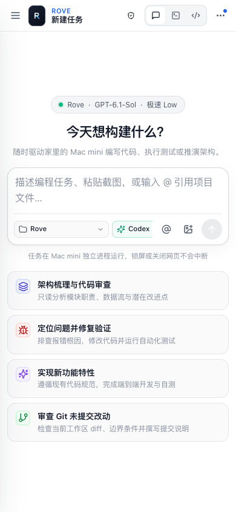

# Rove · Self-Hosted Vibe Coding Web UI for Desktop and Mobile

[简体中文](./README.md) · **English**

Rove is an open-source, self-hosted AI coding Web UI for Codex, Antigravity, Claude Code, and other configured agents. Use it for browser-based and mobile vibe coding. Control your host's AI coding tools from a desktop browser, phone, or tablet. Start a task on your computer, check its progress on your phone, answer agent questions, and continue the same conversation with another model or engine.

Rove runs a FastAPI control plane and React PWA on your workstation. Your repositories, runtime configuration, and local credentials are stored on the host. Requests to AI services follow the configuration of each engine.

## Screenshots from the running application


<details>
<summary>Mobile workspace</summary>



</details>

## What makes Rove useful

| Feature | How it works |
| --- | --- |
| Visible model quotas | Inspect Codex five-hour and weekly limits, Antigravity model quotas, and reset countdowns. Available fields depend on the engine response. |
| Continue with another model | Change the model within a conversation and continue with the existing task history. |
| Cross-engine handoff | Switch between Codex, Antigravity, and configured agents. Rove prepares textual context from conversation history, project conventions, and file changes for the receiving engine. |
| Remote control & file preview | View streamed output, code changes, terminal sessions, questions, approvals, and inline preview/download for project files (Markdown, PDF, media, source) through a browser or installed PWA. |
| Persistent project memory | Store development conventions, architecture decisions, and build commands for later conversations. |
| Parallel Git workspaces | Isolate concurrent changes with Git Worktrees, inspect diffs, and squash-merge completed work. |
| Apple Watch & multi-surface approvals | Receive encrypted Web Push on iPhone (mirrored to Apple Watch), approve from the wrist via 1-step Watch Shortcuts (`POST /api/watch/approve`) or the native `RoveWatch` watchOS target, or use `/eink` and Feishu with atomic approval locking. |

For example, use Codex to analyze a bug, switch to Antigravity to continue implementation, and return to Codex to review the changes. Rove keeps the conversation together and prepares context for engine transitions. Review and test the resulting code as part of your workflow.

## Engine integrations

- **Codex** connects through `codex app-server` JSON-RPC, with streamed events, approvals, questions, model discovery, quotas, and optional cloud task submission.
- **Antigravity** connects to the locally available Connect-RPC Hub or the configured `agy` CLI. Model availability depends on the installed engine and account.
- **Additional agents** include presets for Claude Code, Gemini CLI, Aider, OpenCode, and OpenAI-compatible HTTP providers such as Ollama, vLLM, DeepSeek, and OpenRouter.
- **Reliability & Multi-Account Autonomy** adds quota-reset auto-continue, expiring-quota urgency routing, isolated multi-account pools (`CODEX_HOME` / `CLAUDE_CONFIG_DIR` with device-auth login), isolated read-only `/review` with untracked-file freshness checks, layered `ToolLoopGuard`, zero-trace secret handoffs (`0600` ephemeral IPC), session queuing/forking, vision-bridge translation for text-only models, HMAC-verified GitHub doorbell webhooks, and `rove-ui` semantic cards.
- **Hidden Git Checkpoints, Scratch Sessions & ACP Driver** captures non-intrusive per-turn checkpoints (`refs/rove/checkpoints/...`) with turn diff & 1-click revert (`workstation/checkpoints.py`), zero-project Scratch sessions with 1-click promotion to permanent Git projects (`workstation/scratch.py`), an ACP (`Agent Client Protocol`) stdio JSON-RPC 2.0 driver (`workstation/agents.py`), `pruned_through_seq` cursor-reset snapshot sync, in-pane Git Commit & Push, Composer message quoting, `ArrowUp` last-prompt recall, and large-paste (`>= 32 KB`) auto-attachment.

Existing engine subscriptions retain their own limits. HTTP API providers may charge for usage.

## Architecture

```text
Browser / PWA / E-Ink / Watch / Feishu
                  |
           HTTPS or local HTTP
                  |
       FastAPI + React PWA on host
         |-- SQLite WAL: sessions, events, approvals, memory
         |-- Detached workers: Codex / Antigravity / configured agents
         |-- Detached PTY broker: shell, Git, builds, tests
         |-- Git Worktrees: isolated parallel changes
         `-- Snapshots: backup and PVE recovery
```

Task processes run independently of the browser connection and web server. The host and underlying engines must remain available. Desktop synchronization, engine-specific behavior, and remote notifications depend on the installed tools and environment.

The repository also includes retention tools for event storage, SQLite backups, and PVE snapshot export/import with workspace path remapping. See the [architecture and engineering notes in Chinese](./docs/ARCHITECTURE.md).

## Quick start

Use macOS or Linux with Python 3.11+. Install and authenticate at least one supported engine. Node.js 22+ is required when rebuilding the frontend. Prebuilt frontend assets are included.

```bash
git clone https://github.com/actmas/rove.git
cd rove
bash scripts/quickstart.sh
```

Read the generated password locally and start the server.

```bash
cat ~/.config/walking-workstation/access-password.txt
./.venv/bin/python -m uvicorn workstation.server:app --host 127.0.0.1 --port 8765
```

Visit `http://127.0.0.1:8765`. To install a background service or change the password, use the following commands.

```bash
./.venv/bin/python scripts/manage.py install
./.venv/bin/python scripts/manage.py password
```

Runtime data defaults to `~/.config/walking-workstation/`. Set `WORKSTATION_DATA` to use another directory. Configure project roots, allowed hosts, origins, and endpoint URLs using [config.example.json](./config.example.json) and [.env.example](./.env.example).

## Remote access from your phone

Start Rove locally and configure an access password, then choose a connection method.

### Local network

Bind to the LAN interface and allow trusted devices through the host firewall.

```bash
./.venv/bin/python -m uvicorn workstation.server:app --host 0.0.0.0 --port 8765
```

In the runtime `config.json`, add the host's LAN IP to `allowed_hosts`, add `http://IP:8765` to `origins`, and update `lan_url`. Preserve existing configuration fields. Open that address on a phone connected to the same network.

### Cloudflare Tunnel and a custom domain

Use a Cloudflare account, a domain on Cloudflare, and `cloudflared` installed on the host.

1. Run Rove at `http://127.0.0.1:8765`.
2. Create a Tunnel and configure its connector credentials locally using Cloudflare's setup instructions.
3. Map `rove.example.com` to `http://127.0.0.1:8765`. A connector on another machine needs a reachable host address.
4. Configure a Cloudflare Access self-hosted application and an identity allow policy for the domain, then verify that access requires authentication.
5. Merge the following fields into Rove's runtime `config.json`, substitute your domain, and restart Rove.

```json
{
  "allowed_hosts": ["localhost", "127.0.0.1", "rove.example.com"],
  "origins": ["http://localhost:8765", "http://127.0.0.1:8765", "https://rove.example.com"],
  "public_base_url": "https://rove.example.com"
}
```

Tunnel uses outbound connections and typically requires no router port forwarding. With a connector on the same host, Rove can stay bound to loopback. HTTPS provides the secure context needed for PWA installation and Web Push. Follow the [official Cloudflare Tunnel setup guide](https://developers.cloudflare.com/tunnel/get-started/).

### Tailscale Serve

Install Tailscale on the host and phone, join the same tailnet, and keep Rove bound to loopback.

```bash
tailscale serve --bg http://127.0.0.1:8765
```

Complete the HTTPS setup when prompted. Add the hostname from the output to `allowed_hosts`, add its HTTPS origin to `origins`, and set `public_base_url`. Restart Rove, connect the phone to Tailscale, and open the resulting URL. See the [official Tailscale Serve reference](https://tailscale.com/docs/reference/tailscale-cli/serve).

After connecting, check quotas, history, streaming, and an approval or question submission. For a 403 response, check the configured host, scheme, and port. Other reverse proxies must support WebSocket forwarding and use a narrowly scoped list of trusted proxy addresses.

## Use cases

- **Mobile vibe coding** — continue host-based coding tasks from your phone's browser.
- **Codex and Claude Code Web UI** — operate configured coding agents through one web interface.
- **Cross-model coding workflows** — continue analysis, implementation, and review within a shared conversation.
- **Self-hosted AI coding assistant** — run against local repositories and terminals on macOS, Linux, or PVE.

## Operations and verification

```bash
./.venv/bin/python scripts/manage.py status
./.venv/bin/python scripts/manage.py backup
./.venv/bin/python scripts/manage.py storage
./.venv/bin/python scripts/manage.py snapshot-export
./.venv/bin/python -m unittest discover -s tests -v
node --test tests/*.test.mjs
```

The host terminal and agents operate with the host user's permissions. Use authenticated HTTPS access for remote use. Passwords use salted scrypt hashes, and write requests are subject to origin and client-header checks. Interrupted tasks are reconciled without automatically replaying prompts.

## License

Copyright (c) 2026 actmas. Released under the [MIT License](./LICENSE).
