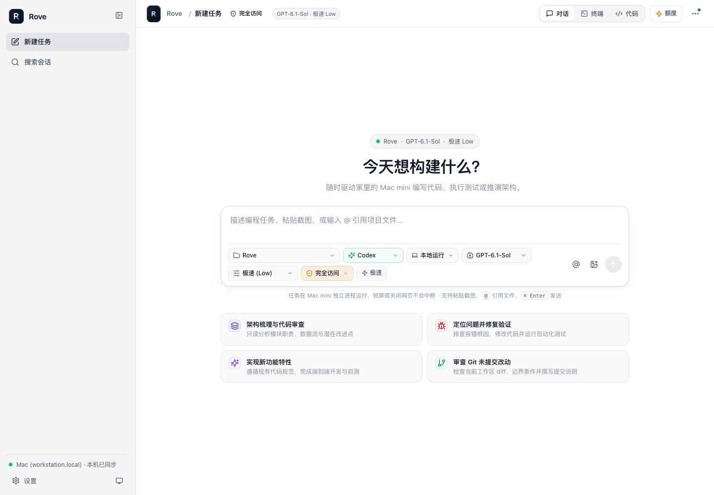
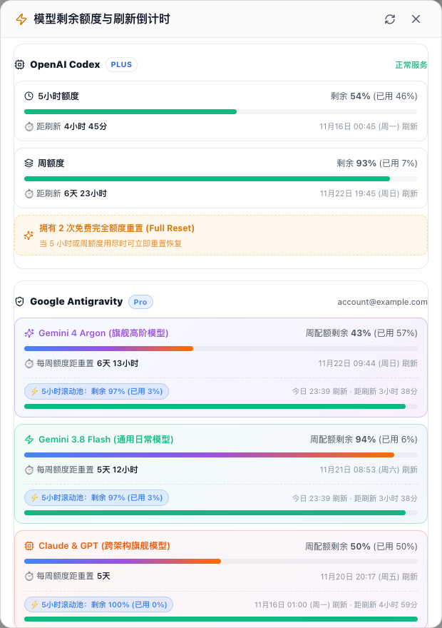

# Rove · Local-First Multi-Agent AI Coding Workstation

[简体中文](./README.md) · **English**

Control your host's AI coding tools from a desktop browser, phone, or tablet. Start a task on your computer, check its progress on your phone, answer agent questions, and continue the same conversation with another model or engine.

Rove runs a FastAPI control plane and React PWA on your workstation. Your repositories, runtime configuration, and local credentials are stored on the host. Requests to AI services follow the configuration of each engine.

## Screenshots from the running application

Captured from a locally running Rove instance on November 15, 2026. The email address and project name were anonymized, and the session list was hidden. Quota values reflect the account state at capture time and vary by account, model, and time. The application UI shown here is in Chinese.





<details>
<summary>Mobile workspace</summary>


</details>

## What makes Rove useful

| Feature | How it works |
| --- | --- |
| Visible model quotas | Inspect Codex five-hour and weekly limits, Antigravity model quotas, and reset countdowns. Available fields depend on the engine response. |
| Continue with another model | Change the model within a conversation and continue with the existing task history. |
| Cross-engine handoff | Switch between Codex, Antigravity, and configured agents. Rove prepares textual context from conversation history, project conventions, and file changes for the receiving engine. |
| Remote control of host tasks | View streamed output, code changes, terminal sessions, questions, and approvals through a browser or installed PWA. |
| Persistent project memory | Store development conventions, architecture decisions, and build commands for later conversations. |
| Parallel Git workspaces | Isolate concurrent changes with Git Worktrees, inspect diffs, and squash-merge completed work. |
| Multiple notification surfaces | Configure Web Push and Feishu notifications, with dedicated e-ink approval and watch monitoring pages. |

For example, use Codex to analyze a bug, switch to Antigravity to continue implementation, and return to Codex to review the changes. Rove keeps the conversation together and prepares context for engine transitions. Review and test the resulting code as part of your workflow.

## Engine integrations

- **Codex** connects through `codex app-server` JSON-RPC, with streamed events, approvals, questions, model discovery, quotas, and optional cloud task submission.
- **Antigravity** connects to the locally available Connect-RPC Hub or the configured `agy` CLI. Model availability depends on the installed engine and account.
- **Additional agents** include presets for Claude Code, Gemini CLI, Aider, OpenCode, and OpenAI-compatible HTTP providers such as Ollama, vLLM, DeepSeek, and OpenRouter.

Existing engine subscriptions retain their own limits. HTTP API providers may charge for usage.

## Architecture

```text
Browser / PWA / E-Ink / Watch / Feishu
                  |
           HTTPS or local HTTP
                  |
       FastAPI + React PWA on host
         |-- SQLite WAL: sessions, events, approvals, memory
         |-- Detached workers: Codex / Antigravity / configured agents
         |-- Detached PTY broker: shell, Git, builds, tests
         |-- Git Worktrees: isolated parallel changes
         `-- Snapshots: backup and PVE recovery
```

Task processes run independently of the browser connection and web server. The host and underlying engines must remain available. Desktop synchronization, engine-specific behavior, and remote notifications depend on the installed tools and environment.

The repository also includes retention tools for event storage, SQLite backups, and PVE snapshot export/import with workspace path remapping. See the [architecture and engineering notes in Chinese](./docs/ARCHITECTURE.md).

## Quick start

Use macOS or Linux with Python 3.11+. Install and authenticate at least one supported engine. Node.js 22+ is required when rebuilding the frontend. Prebuilt frontend assets are included.

```bash
git clone https://github.com/actmas/rove.git
cd rove
bash scripts/quickstart.sh
```

Read the generated password locally and start the server.

```bash
cat ~/.config/walking-workstation/access-password.txt
./.venv/bin/python -m uvicorn workstation.server:app --host 127.0.0.1 --port 8765
```

Visit `http://127.0.0.1:8765`. To install a background service or change the password, use the following commands.

```bash
./.venv/bin/python scripts/manage.py install
./.venv/bin/python scripts/manage.py password
```

Runtime data defaults to `~/.config/walking-workstation/`. Set `WORKSTATION_DATA` to use another directory. Configure project roots, allowed hosts, origins, and endpoint URLs using [config.example.json](./config.example.json) and [.env.example](./.env.example).

## Operations and verification

```bash
./.venv/bin/python scripts/manage.py status
./.venv/bin/python scripts/manage.py backup
./.venv/bin/python scripts/manage.py storage
./.venv/bin/python scripts/manage.py snapshot-export
./.venv/bin/python -m unittest discover -s tests -v
node --test tests/*.test.mjs
```

The host terminal and agents operate with the host user's permissions. Use authenticated HTTPS access for remote use. Passwords use salted scrypt hashes, and write requests are subject to origin and client-header checks. Interrupted tasks are reconciled without automatically replaying prompts.

## License

Copyright (c) 2026 actmas. Released under the [MIT License](./LICENSE).
