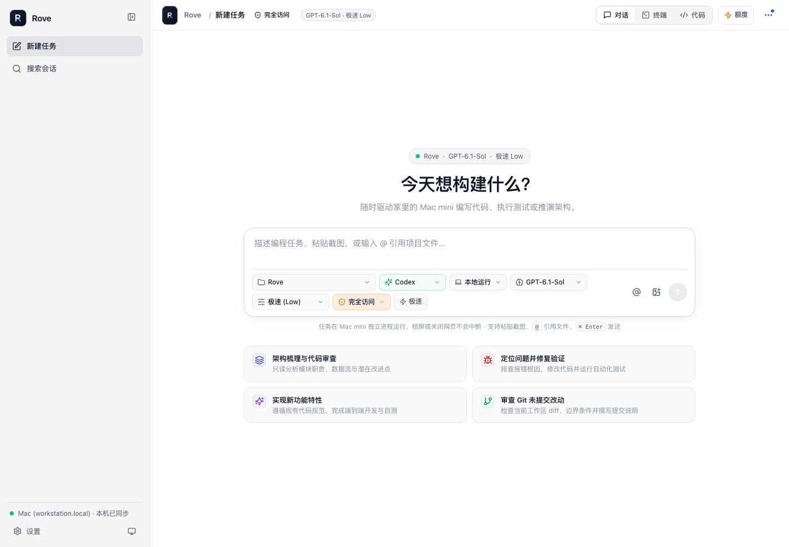
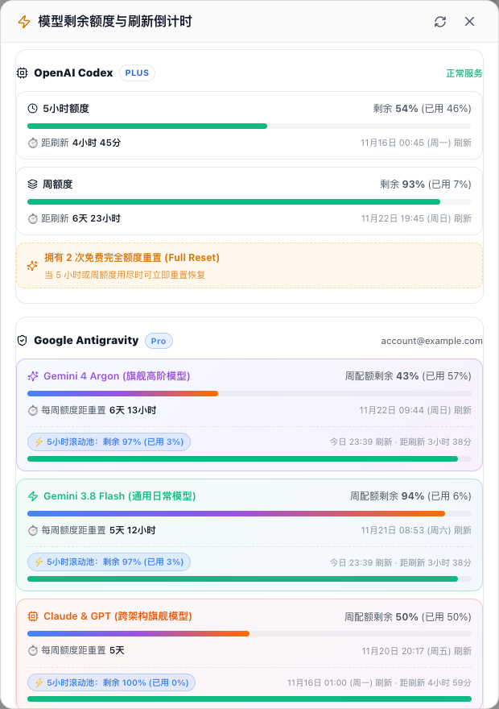
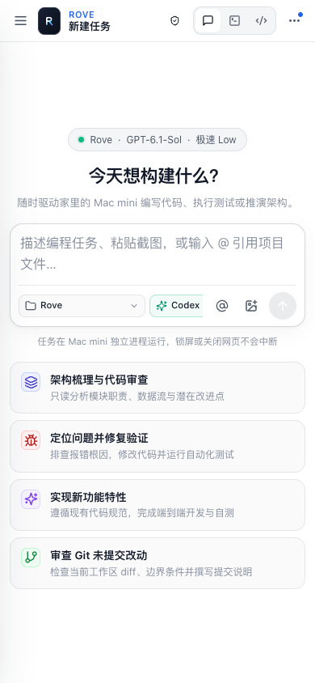

# Rove · 网页与手机上的 Vibe Coding 工作台

**简体中文** · [English](./README.en.md)

<p align="center">
  <strong>通过浏览器远程控制 Codex、Antigravity 与 AI 编程 Agent</strong><br/>
  <sub>OpenAI Codex · Google Antigravity · Claude Code · Gemini CLI · Aider · OpenCode · Persistent PTY · Git Worktree Pool</sub>
</p>

<p align="center">
  <a href="./LICENSE"></a>
  
  
  
  
</p>

---

## 用手机继续电脑上的编程任务

Rove 是开源、自托管的网页 AI 编程工作台（Web UI），支持通过手机、平板和电脑浏览器进行 Vibe Coding。它把本机 Codex、Antigravity、Claude Code 等 AI 编程工具集中到一个可远程访问的界面。你可以在电脑上开始任务，在手机上查看进展、回答问题和处理审批，也可以在同一个会话中切换模型或引擎继续工作。

### 实际运行界面





<details>
<summary>查看手机端实际界面</summary>



</details>

### 项目特色

| 能力 | 使用方式 |
| --- | --- |
| 模型额度可见 | 在额度面板查看 Codex 的 5 小时和周额度、Antigravity 模型额度与刷新倒计时。可用字段取决于引擎返回的数据。 |
| 同一任务跨模型继续 | 在当前会话切换模型，沿用已有任务记录继续交流。 |
| 跨引擎接力 | 从 Codex 切换到 Antigravity 等引擎时，结合历史对话、项目约定和文件修改记录生成交接上下文。接收引擎通过文本上下文继续任务。 |
| 手机接管本机工作 | 通过浏览器或 PWA 查看流式输出、代码变更、终端和审批。任务由宿主机执行。 |
| 项目记忆 | 保存开发规范、架构决策和构建命令，并在后续会话中注入。 |
| 并行工作区 | 使用 Git Worktree 隔离不同会话的代码修改，再预览差异和合并。 |
| 多端审批与通知 | 提供网页、墨水屏、手表监控页及可配置的飞书和 Web Push 通知。 |

例如，先让 Codex 分析问题，再切换到 Antigravity 继续实现，随后切回 Codex 审查改动。Rove 保留统一会话记录，并为跨引擎切换准备交接内容。实际代码修改仍需审查和测试。

## 为什么选择 Rove？

**Rove（行走工作台）** 是一个运行在个人工作站（Mac mini / macOS / Linux / Proxmox VE）上的 **Local-First 多引擎 AI 编程工作台**。

它将重度计算、本地代码仓库、Git 树以及本机已授权的客户端登录态（`ChatGPT.app / Codex CLI`、`Gemini.app / Antigravity`、`Claude Code` 等）保存在你的宿主机上，而向手机、平板、笔记本、墨水屏、智能手表提供远程控制界面：

- **复用本机已配置的引擎**：连接宿主机已登录的 Codex (`app-server`) 与 Antigravity (`Connect-RPC` 本地 Hub / `agy` CLI)。订阅额度与限制由对应服务决定，使用 HTTP API 时按提供商规则计费。
- **脱离浏览器生命周期的持久运行**：AI 任务 (`worker.py`) 与 PTY 终端 (`terminal.py`) 作为独立守护进程运行（macOS 下自动持有 `caffeinate -i` 防止空闲休眠）。任务进程独立于网页连接和 Web 服务，便于离开页面后继续运行。宿主机及引擎进程需要保持可用。
- **跨引擎无感接力 (`context_bridge.py`)**：在同一个会话中随时切换 Codex、Antigravity、Claude Code、Gemini CLI、Aider 或 OpenAI 兼容模型，系统在后台自动合成 Token 高效的增量交接上下文（Delta Handoff），无需重复解释背景。
- **Mac 桌面端与移动端双向实时同步 (`codex_sync.py` & `antigravity_sync.py`)**：无论是在电脑桌面端 `ChatGPT.app` / `Antigravity.app` 发起的对话，还是在手机上发起的任务，双方历史记录、思考过程、命令输出、文件 Diff、Token 用量与写入锁状态实时双向对齐。

> 📖 **深入了解设计思想与工程实现**：请参阅 [《Rove 架构设计与核心工程方法论白皮书》](./docs/ARCHITECTURE.md)。

---

## Core Features

### 1. 多引擎原生适配与可插拔 Agent 中心
- **OpenAI Codex 原生协议 (`workstation/rpc.py`)**：对接 `codex app-server` JSON-RPC 2.0，支持流式推理摘要、实时命令输出、文件变更卡片、交互式单次审批与提问回答、Priority 2x 极速通道，以及 `codex cloud exec` 云端环境投递。
- **Google Antigravity 双通道 (`workstation/antigravity_hub.py`)**：优先自动发现并连接本机 `Gemini.app` / `Antigravity.app` 的本地 `Connect-RPC` Hub（使用宿主机已有登录状态，模型和图片能力取决于本机引擎），无桌面端时平滑回退至独立 `agy` CLI。
- **通用多 Agent 扩展中心 (`workstation/agents.py`)**：内置 **Claude Code** (`claude`)、**Gemini CLI** (`gemini`)、**Aider** (`aider`)、**OpenCode** (`opencode`) 与 **OpenAI 兼容 HTTP API**（DeepSeek / OpenRouter / Ollama / vLLM）一键预设，支持动态注册任意自定义 CLI 或 HTTP Agent。
- **实时模型目录与剩余额度监控 (`workstation/quotas.py`)**：动态同步本机可用模型与推理强度档位（`Low` / `Medium` / `High` / `X-High` / `Max` / `Ultra`），实时展示 5 小时滚动窗口与周配额百分比及刷新倒计时。

### 2. 上下文工程与并行代码治理
- **Git Worktree 并行隔离池 (`workstation/worktree.py`)**：同一主工作区默认互斥防冲突；一键开启会话独立 Worktree（`.worktrees/rove-<id>`，自动写入 `.git/info/exclude` 零污染仓库），即可实现多 Agent 并发修改同一仓库，完成后支持三点 Diff 预览与一键 `Squash Merge`。
- **跨会话持久记忆 (`workstation/memories.py`)**：借鉴 `claude-mem`，持久化保存项目的【开发规范】、【架构决策】、【硬性红线】与【构建测试】命令，支持从对话中自动提取并在新会话启动时按置顶优先级自动注入。
- **Anti-AI-Slop 前端审美守卫 (`workstation/design_guard.py`)**：识别前端/UI 任务时自动注入项目设计规范（拒绝俗套紫粉霓虹渐变与浓黑大阴影，推行中性表面分层、`1px` 半透明微边框、细腻圆角与完整 `:hover/:active/:focus-visible` 状态机），并提供代码静态审计。

### 3. 全场景多端触点与原子审批
- **PWA 独立应用与自托管 Web Push (`workstation/webpush.py`)**：内置 RFC 8292 (`ES256`) VAPID 签名与 RFC 8291 (`aes128gcm`) 端到端加密推送引擎（基于系统 `libcrypto`，零第三方推送 SaaS 依赖）。当后台任务等待权限审批或执行完成时，实时推送到 iOS / Android 锁屏通知中心。
- **墨水屏极简审批台 (`/eink`) & 智能手表监控 (`/watch/live`)**：专为 Kindle/文石等墨水屏浏览器定制的高对比度零动画审批视图，以及适合 Apple Watch / 小屏设备的实时进度监控页。
- **飞书多端协同机器人 (`workstation/feishu_relay.py`)**：高危命令待审批与任务完成主动推送至飞书，支持直接回复 `/approve <id>` 或 `/reject <id>` 远程决策，与网页、墨水屏共享 SQLite 事务级原子审批锁 (`store.decide_approval`)。

### 4. 数据生命周期治理与 PVE 跨平台容灾自愈
- **SQLite 事件压缩与在线瘦身 (`workstation/retention.py`)**：一键诊断表空间占用，自动精简已结束会话的流式 `delta` 碎片与内嵌大图 Blob（保留完整对话与代码变更），支持 Dry-Run 演练、自动备份与在线 `VACUUM`。
- **PVE 主备容灾与缺失文件一键自愈 (`workstation/cluster_sync.py`)**：支持将 SQLite 热备、自定义 Agent 配置及所有登记项目源码打包为独立快照，一键同步至 Proxmox VE (PVE) 备用节点（自动完成 macOS `/Users/...` ⇄ Linux `/var/lib/...` 跨平台路径重映射），并支持 `only_missing_files` 模式精准恢复误删文件。

---

## Architecture Overview

```text
iPhone / iPad / Android / Desktop Browser / E-Ink / Watch / Feishu
        │ HTTPS (Cloudflare Access / Reverse Proxy) or LAN HTTP + Scrypt Auth
        ▼
Host Workstation :8765 · FastAPI Control Plane + React 19 PWA
        ├── SQLite WAL (state.sqlite3)：会话、任务、增量事件游标、原子审批、持久记忆
        ├── Detached Worker → Codex app-server (JSON-RPC) ⇄ ~/.codex 双向实时同步
        ├── Detached Worker → Antigravity Hub (Connect-RPC) / agy CLI ⇄ 宿主授权复用
        ├── Detached Worker → Pluggable Agents (Claude Code / Gemini CLI / Aider / HTTP API)
        └── Detached PTY Broker → Login Shell (zsh/bash) → Git / Compilers / Test Suites
```

---

## Quick Start

### 环境要求
- **操作系统**：macOS 13+（推荐 Mac mini 作为常驻主机）或 Linux（Debian 12+ / Ubuntu 22.04+ / Proxmox VE LXC）
- **运行时**：Python `3.11+`；如需修改并重新构建前端需 Node.js `22+`（仓库已预置构建好的生产静态产物，开箱即用）
- **可选 AI 引擎**：本机已安装并登录 `ChatGPT.app` / `codex` CLI、`Gemini.app` / `Antigravity.app` / `agy` CLI、`claude` CLI 等任意其一即可

### 1. 一键初始化与本地启动

```bash
git clone https://github.com/actmas/rove.git
cd rove

# 自动创建虚拟环境、安装依赖、初始化 ~/.config/walking-workstation 并生成初始随机密码
bash scripts/quickstart.sh
```

查看首次生成的随机访问密码（权限 `0600`，仅保存在本机）：

```bash
cat ~/.config/walking-workstation/access-password.txt
```

启动开发/前台服务，或直接注册为系统后台自启守护服务（macOS `LaunchAgent` / Linux `systemd`）：

```bash
# 方式 A：直接前台启动
./.venv/bin/python -m uvicorn workstation.server:app --host 127.0.0.1 --port 8765

# 方式 B：安装为登录后后台自启守护服务（推荐）
./.venv/bin/python scripts/manage.py install
```

打开浏览器访问 `http://127.0.0.1:8765`，输入密码即可进入工作台。

### 2. 修改专属访问密码

```bash
./.venv/bin/python scripts/manage.py password
```
> 密码采用 `scrypt` 哈希加盐存储于 `~/.config/walking-workstation/auth.json`，修改后会自动销毁初始明文密码文件并吊销所有历史登录会话。

---

## 外网访问与手机远程编程

先完成本地启动和访问密码设置，再选择连接方式。手机连接后即可查看任务、切换模型、继续对话和处理审批。

| 访问方式 | 适用场景 | 浏览器地址 |
| --- | --- | --- |
| 局域网 | 手机与工作站连接同一网络 | `http://工作站局域网IP:8765` |
| Tailscale Serve | 自己的设备通过 Tailscale 远程连接 | Serve 输出的 HTTPS 地址 |
| Cloudflare Tunnel + Access | 使用自定义域名，通过浏览器从外网登录 | `https://rove.example.com` |

### 局域网访问

将监听地址设为 `0.0.0.0`，并在工作站防火墙允许可信局域网设备访问该端口。

```bash
./.venv/bin/python -m uvicorn workstation.server:app --host 0.0.0.0 --port 8765
```

在实际运行数据目录的 `config.json` 中，将工作站 IP 加入 `allowed_hosts`，把完整的 `http://IP:8765` 加入 `origins`，并更新 `lan_url`。保留已有配置字段和本机地址。手机访问该地址并输入 Rove 密码。

### 使用 Cloudflare Tunnel 和自定义域名

需要 Cloudflare 账号、已接入 Cloudflare 的域名，以及安装在工作站上的 `cloudflared`。

1. 保持 Rove 运行于 `http://127.0.0.1:8765`。
2. 按 Cloudflare 的安装指引创建 Tunnel，并在工作站本地配置连接器凭据。
3. 添加应用路由，将自定义主机名 `rove.example.com` 指向服务 `http://127.0.0.1:8765`。若连接器运行在另一台机器，使用它实际可达的工作站地址。
4. 为该域名配置 Cloudflare Access 自托管应用及允许登录的身份策略，然后验证域名访问会进入身份验证流程。
5. 合并以下字段到 Rove 的 `config.json`，然后重启 Rove 服务。将示例域名替换为自己的域名。

```json
{
  "allowed_hosts": ["localhost", "127.0.0.1", "rove.example.com"],
  "origins": ["http://localhost:8765", "http://127.0.0.1:8765", "https://rove.example.com"],
  "public_base_url": "https://rove.example.com"
}
```

Tunnel 通过出站连接提供访问，通常无需在路由器上转发端口。连接器与 Rove 同机时，可以让 Rove 继续监听回环地址。HTTPS 也为 PWA 安装和 Web Push 提供所需的安全上下文。安装与路由步骤见 [Cloudflare Tunnel 官方文档](https://developers.cloudflare.com/tunnel/get-started/)。

### 使用 Tailscale Serve

在工作站和手机上安装并登录同一个 tailnet，保持 Rove 监听 `127.0.0.1:8765`，在工作站执行以下命令。

```bash
tailscale serve --bg http://127.0.0.1:8765
```

按照命令提示完成 HTTPS 设置。把输出地址的主机名加入 `allowed_hosts`，将完整 HTTPS 来源加入 `origins`，并写入 `public_base_url`。重启 Rove 后，在已连接 Tailscale 的手机浏览器中打开该地址。配置方法见 [Tailscale Serve 官方文档](https://tailscale.com/docs/reference/tailscale-cli/serve)。

### 连接后检查

登录后检查额度面板、会话历史和流式输出，确认一次提问或审批能够正常提交。若页面能打开但操作返回 403，核对 `allowed_hosts` 与 `origins` 中的域名、协议和端口。使用其他反向代理时，需要同时转发 WebSocket 连接，并仅信任实际使用的代理地址。

## 常见使用场景

- **手机 Vibe Coding** — 外出时通过网页继续电脑上的 AI 编程任务。
- **Codex / Claude Code Web UI** — 把已配置的命令行编程工具集中到浏览器界面。
- **跨模型协作编程** — 在统一会话中切换模型或引擎，接续分析、实现与代码审查。
- **自托管 AI 编程助手** — 在 Mac mini、Linux 主机或 PVE 环境运行，连接本地仓库和终端。

## Configuration & Operations

所有运行时配置与数据库均保存在源码树之外的 `~/.config/walking-workstation/`（可通过环境变量 `WORKSTATION_DATA` 自定义路径），确保代码仓库绝对干净。

你可以通过参考仓库根目录的 [`config.example.json`](./config.example.json) 与 [`.env.example`](./.env.example) 自定义允许访问的项目根目录、局域网/公网域名与二进制路径：

```json
{
  "allowed_roots": [
    "/Users/yourname/Projects",
    "/Users/yourname/Documents/Codex"
  ],
  "allowed_hosts": ["localhost", "127.0.0.1", "192.168.1.100", "rove.example.com"],
  "origins": ["http://localhost:8765", "http://192.168.1.100:8765", "https://rove.example.com"],
  "lan_url": "http://192.168.1.100:8765",
  "public_base_url": "https://rove.example.com"
}
```

### 常用运维管理命令 (`scripts/manage.py`)

```bash
# 查看守护服务运行状态
./.venv/bin/python scripts/manage.py status

# 创建一致性 SQLite 在线热备份
./.venv/bin/python scripts/manage.py backup

# 查看 SQLite 存储健康度与流式事件碎片报告
./.venv/bin/python scripts/manage.py storage

# 安全精简 14 天前的过程事件碎片、自动备份并执行 VACUUM 释放物理空间
./.venv/bin/python scripts/manage.py prune --days 14 --backup

# 导出包含数据库、Agent 配置与项目源码的全量容灾快照
./.venv/bin/python scripts/manage.py snapshot-export

# 一键自愈恢复本地误删的项目文件（不覆盖现有未提交修改）
./.venv/bin/python scripts/manage.py snapshot-import --heal-missing

# 一键将工作台模版部署至 Proxmox VE (PVE) 备用节点或 LXC 容器
./.venv/bin/python scripts/manage.py pve-deploy --host pve-home --ctid 108
```

---

## Testing & Verification

Rove 包含完整的后端单元/回归测试套件与前端逻辑测试套件：

```bash
# 运行 Python 后端测试套件（鉴权、并发锁、跨引擎上下文桥接、Worktree、记忆、飞书回调、数据压缩等）
./.venv/bin/python -m unittest discover -s tests -v

# 运行前端事件解析器、模型目录、历史缓存与 Service Worker 测试
node --test tests/*.test.mjs
```

---

## Security & Operating Boundaries

1. **认证与防跨站保护**：密码经 `scrypt (N=16384, r=8, p=1)` 哈希存储；会话 Cookie 强制 `HttpOnly` 与 `SameSite=Strict`（HTTPS 下自动启用 `Secure`）；所有写接口强制校验 `Origin`/`Host` 白名单与自定义请求头 `X-Workstation-Client`。
2. **文件浏览与终端边界**：内置代码浏览器为只读模式，严格拦截路径穿越（`..`）、隐藏文件与目录外符号链接；持久 PTY 终端运行在宿主机当前用户权限下，建议在公网暴露时前置 Cloudflare Access 或 Tailscale / WireGuard。
3. **安全中断与非自动重放**：若宿主机断电或重启导致任务进程非正常终止，`store.reconcile()` 会在恢复时将其安全标记为中断，绝不自动重放可能已经修改过工作区文件的 Prompt。

---

## License

Released under the [MIT License](./LICENSE).
