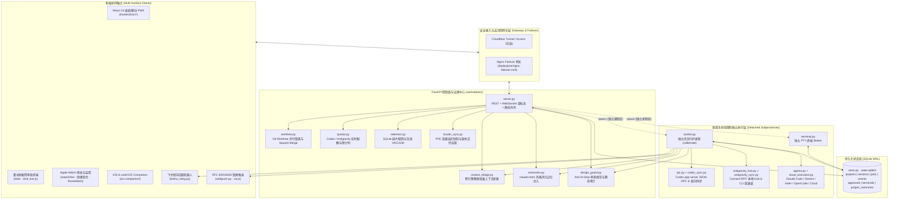

# Rove 架构设计与核心工程方法论 (Architecture & Engineering Methodology)

本文档系统总结 **Rove（行走工作台）** 的核心设计思想、分层架构拓扑以及八项可复用的关键工程方法。无论你是将 Rove 部署为自己的随身 AI 编程工作站，还是希望在自己的多 Agent 系统中借鉴其中的上下文桥接、双引擎同步、Git Worktree 并行池或零依赖 Web Push 方案，均可参考本白皮书。

---

## 一、 核心设计哲学 (Core Design Philosophy)

### 1. 计算与视图彻底分离 (Zero-State Client, Local-First Execution)
- **痛点**：移动端/平板/轻薄设备无法运行完整开发环境，而纯云端 Coding Agent 又面临高昂的按 Token 计费、环境配置繁琐、无法访问本机私有仓库与内网环境等问题。
- **思路**：宿主工作站（Mac mini / Linux 主机）100% 承载代码树、编译器、Git 状态以及 **本机已登录的订阅态客户端**（`ChatGPT.app` / `Codex CLI` 与 `Gemini.app` / `Antigravity`）；客户端浏览器只传输轻量 JSON 事件流、PTY 终端字节流与代码 Diff。

### 2. 进程生命周期与网络请求彻底解耦 (Detached Process Lifetimes)
- **痛点**：移动网络抖动、手机锁屏切后台、甚至 Web 服务自身升级重启，极易导致传统基于 HTTP Streaming / WebSocket 绑定的 Agent 任务中断。
- **思路**：Web 控制面（`workstation/server.py`）绝不直接持有模型推理或 Shell 会话。每次启动任务或终端，均通过独立进程组派生 `workstation/worker.py` 或 `workstation/terminal.py`（macOS 下配合 `caffeinate -i` 与 `AbandonProcessGroup`，Linux 下配合 `KillMode=process`）。浏览器断开甚至重启 FastAPI 服务，后台任务与终端依然持续执行。

### 3. 单一事实来源与游标无损恢复 (SQLite WAL Single Source of Truth)
- **思路**：所有会话元数据、任务状态、流式增量输出（`events`）、终端输入输出队列（`terminal_input` / `terminal_output`）以及待处理审批（`approvals`）均实时写入开启 `WAL` 模式的 SQLite。任何终端（手机、平板、桌面、墨水屏、手表）重连时，只需携带 `after=<last_event_id>` 游标即可按序追平全部历史与实时增量，**绝不重复触发 Prompt**。

### 4. 多引擎共生与多触点协同 (Multi-Agent Symbiosis & Multi-Surface Presence)
- **横向（多引擎）**：在同一对话流中支持 OpenAI **Codex**、Google **Antigravity**、**Claude Code**、**Gemini CLI**、**Aider**、**OpenCode** 及任意 **OpenAI 兼容 API** 无缝切换接力。
- **纵向（多触点）**：同一套后端状态机同时驱动 **桌面/移动响应式 Web (PWA)**、**iOS & watchOS 原生伴侣应用 (`ios-companion/Rove`, `RoveWatch`)**、**Apple Watch 实时监控与快速审批 (`/watch/live` & 1 步快捷指令 API)**、**Kindle/墨水屏高对比审批台 (`/eink`)**、**飞书双向机器人 (`feishu_relay.py`)** 以及 **系统级锁屏 Web Push (`webpush.py`)**。

---

## 二、 系统分层架构与模块拓扑 (System Architecture & Module Topology)

### 核心代码目录映射

| 目录 / 模块 | 职责定位 | 关键技术点 |
| :--- | :--- | :--- |
| [`workstation/server.py`](../workstation/server.py) | FastAPI 核心控制面 | Scrypt 密码鉴权、Origin/CSRF 校验、WebSocket 游标推送、PWA 资源服务 |
| [`workstation/store.py`](../workstation/store.py) | SQLite WAL 状态与事务层 | 线程安全连接池、Savepoint 嵌套事务、`decide_approval` 原子审批锁 |
| [`workstation/worker.py`](../workstation/worker.py) | 独立后台任务执行器 | 100ms/8KB 流式 Delta 聚合写入、多端等待审批挂起、安全中断 (`turn/interrupt`) |
| [`workstation/rpc.py`](../workstation/rpc.py) | Codex JSON-RPC 2.0 客户端 | 对接 `codex app-server`，支持 `thread/start`、`thread/resume` 与交互式权限回调 |
| [`workstation/codex_sync.py`](../workstation/codex_sync.py) | 本机 Codex 双向实时同步 | 只读挂载 `~/.codex/state_5.sqlite`、增量解析 `rollout-*.jsonl`、感知 `thread-writer-locks` |
| [`workstation/antigravity_hub.py`](../workstation/antigravity_hub.py) | Antigravity Connect-RPC 客户端 | 自动发现本机 `Gemini.app`/`Antigravity.app` 的 `agy --hub` 进程与 CSRF 令牌，复用宿主 Pro 授权 |
| [`workstation/antigravity_sync.py`](../workstation/antigravity_sync.py) | Antigravity 会话增量同步 | 实时同步本机 Antigravity 历史轨迹、思考流与文件修改记录 |
| [`workstation/agents.py`](../workstation/agents.py) | 通用多 Agent 注册与适配器 | 内置 Claude Code / Gemini CLI / Aider / OpenCode / OpenAI API 模版，支持自定义扩展 |
| [`workstation/context_bridge.py`](../workstation/context_bridge.py) | 跨引擎上下文无感交接 | 全量/差量 (Delta) 上下文合成、长代码块折叠、回显正则剥离 |
| [`workstation/memories.py`](../workstation/memories.py) | 跨会话项目持久记忆 | 5 大分类（规范/架构/红线/工具/备忘）、Prompt 显式指令自动提取、置顶优先注入 |
| [`workstation/design_guard.py`](../workstation/design_guard.py) | Anti-AI-Slop 前端审美守卫 | UI 意图自动识别、6 条现代设计规范自动注入、4 类 AI Slop 正则静态审计 |
| [`workstation/worktree.py`](../workstation/worktree.py) | Git Worktree 并行隔离池 | `.worktrees/rove-<id>` 自动派生、`.git/info/exclude` 零污染隐藏、一键 Squash Merge |
| [`workstation/feishu_relay.py`](../workstation/feishu_relay.py) | 飞书双向通知与指令回调 | 审批卡片推送、`/approve` & `/reject` 回调验签与 `channel_events` 幂等去重 |
| [`workstation/webpush.py`](../workstation/webpush.py) | 自托管零 SaaS 锁屏推送 | 基于系统 `libcrypto` ctypes 实现 RFC 8292 VAPID `ES256` 签名与 RFC 8291 `aes128gcm` 加密 |
| [`workstation/cluster_sync.py`](../workstation/cluster_sync.py) | 跨平台集群容灾与文件自愈 | 在线热备 + 源码归档、macOS ⇄ Linux 路径自动重映射、`only_missing_files` 误删文件自愈 |
| [`workstation/retention.py`](../workstation/retention.py) | 数据库生命周期治理 | `dbstat` 空间诊断、流式 Delta 与超大图片 Blob 压缩、Dry-Run 演练与在线 `VACUUM` |
| [`workstation/terminal.py`](../workstation/terminal.py) | 独立持久 PTY 终端 Broker | `pty.fork` 真实登录 Shell、`TIOCSWINSZ` 动态尺寸、环形输出截断与重放 |
| [`workstation/quota_wait.py`](../workstation/quota_wait.py) & [`model_router.py`](../workstation/model_router.py) | 限额自动续跑与紧迫度路由 | 重置时刻解析、错峰自动恢复（上限 3 次）、快作废额度优先选路 |
| [`workstation/account_pool.py`](../workstation/account_pool.py) | 多订阅账号池隔离 | `CODEX_HOME` / `CLAUDE_CONFIG_DIR` 隔离、设备码授权、`is_account_authenticated` 守卫 |
| [`workstation/review.py`](../workstation/review.py) & [`loop_guard.py`](../workstation/loop_guard.py) | 独立只读审查与死循环守卫 | 独立 `review` 会话、含未跟踪文件哈希的 Fail-Closed 新鲜度校验、分层工具空转拦截 |
| [`workstation/input_handoff.py`](../workstation/input_handoff.py) & [`vision_bridge.py`](../workstation/vision_bridge.py) | 零留痕代输入与视觉桥 | `0600` 临时跨进程秘密传递（读取即毁）、纯文本模型多模态截图转译 |
| [`workstation/fork.py`](../workstation/fork.py), [`webhooks.py`](../workstation/webhooks.py) & [`rich_ui.py`](../workstation/rich_ui.py) | 分叉、门铃触发与流式富组件 | 任意轮次 Fork、HMAC-SHA256 门铃防注入与冷却、语义配色 `rove-ui` 围栏协议 |
| [`frontend/src/`](../frontend/src/) | React 19 响应式工作台 UI | 双主题视觉系统、思考流/执行计划/内联 Diff/`rove-ui` 渲染、精准路径点亮、多账号直登 |

---

## 三、 八大核心工程方法详解 (8 Reusable Engineering Methods)

### 方法 1：双引擎原生协议桥接与宿主授权复用 (`rpc.py` & `antigravity_hub.py`)
1. **Codex 按回合释放写锁机制**：
   - 官方 `codex app-server` 在持有线程期间会锁定原生会话（`thread-writer-locks`）。
   - Rove 在每个回合启动时通过 `thread/resume`（携带 `excludeTurns: True` 避免全量历史重复传输）恢复同一原生 `threadId`，回合一结束立即 `finally: await rpc.close()` 释放写锁。这样用户在手机上跑完一轮后，回到 Mac 桌面端 `ChatGPT.app` 或 CLI 可以无缝继续同一对话，反之亦然。
2. **Antigravity 双通道自适应（Local Hub 优先 + CLI 回退）**：
   - 独立 `agy` CLI 在部分网络出口下会因缺少桌面宿主认证桥而触发 `region_restricted`。
   - `antigravity_hub.py` 通过扫描当前用户 UID 下的 `agy --hub --hub-port=<port>` 进程，提取本地 CSRF 令牌，直接以 Connect-RPC 协议调用 `/exa.language_server_pb.LanguageServerService/*` 接口，合法复用本机已登录桌面端的宿主会话，完整支持 Pro 模型、图片输入与在线权限审批。

### 方法 2：本机与移动端双向增量同步 (`codex_sync.py` & `antigravity_sync.py`)
- **文件签名快速短路**：每次检查 `~/.codex/state_5.sqlite`、`state_5.sqlite-wal`、`config.toml` 的纳秒级 `mtime_ns` 签名，未变化时 O(1) 零开销返回。
- **只读 URI 挂载与字节偏移增量读取**：以 `file:...?mode=ro` 只读连接原生 SQLite，并记录每个会话 `rollout-*.jsonl` 的字节偏移量 (`codex_rollout_offset`) 与 `synced_codex_items(session_id, item_id)`，严格按 `item_id` 去重，实现桌面端正在输出时手机端同步流式展示。

### 方法 3：Token 高效的静默跨引擎上下文交接 (`context_bridge.py`)
当用户在同一会话中从引擎 A（如 Codex）切换到引擎 B（如 Antigravity 或 Claude Code）时：
1. **自动判定全量 vs. 增量差量交接 (Delta Handoff)**：
   - 若目标引擎 B 在当前会话中已有原生 `native_id`，系统只提取**自引擎 B 上次执行之后**由其他引擎产生的差量轮次（`turns[last_target_idx + 1:]`），避免重复喂入已知上下文。
   - 若目标引擎 B 首次介入该会话，则提取首轮总目标锚点（Anchor Turn）+ 最近 4 轮核心对话。
2. **代码降噪与文件清单提炼**：
   - 自动将前序回复中超过 3 行的代码块折叠为 `[代码详见对应本地文件]`，并附上归一化后的修改文件相对路径清单（最多 12 个），引导新引擎直接读取本地最新文件。
3. **静默注入与回显剥离**：
   - 交接块使用 `<!-- WORKSTATION_BRIDGE_START --> ... <!-- WORKSTATION_BRIDGE_END -->` 包裹，并在同步回显或提取历史时由 `strip_injected_context()` 自动剥离，前端界面保持纯净。

### 方法 4：零仓库污染的 Git Worktree 并行隔离 (`worktree.py`)
- **互斥与并发的平衡**：默认情况下，同一项目主工作区同一时刻只允许一个活跃任务运行以防文件踩踏。
- **一键派生隔离工作树**：开启会话级 Worktree 后，系统自动在 `<project>/.worktrees/rove-<short_id>` 检出独立分支 `rove/<short_id>`，并将 `.worktrees/` 写入 `<project>/.git/info/exclude`（**绝不修改受版本控制的 `.gitignore`**）。
- **三点 Diff 审查与 Squash Merge**：任务完成后，通过 `git diff HEAD...rove/<short_id>` 预览全部改动，校验主工作区干净后执行 `git merge --squash` 一键合入主分支。

### 方法 5：跨会话持久记忆与 Anti-AI-Slop 审美自动守卫 (`memories.py` & `design_guard.py`)
- **持久记忆自动捕获**：正则扫描用户输入中的显式约定（如 `记住：...`、`架构决策：...`、`严禁：...`、`构建命令：...`），自动归类入库并在新会话首轮按置顶优先级注入（控制在 900 字符以内）。
- **Anti-AI-Slop 审美守卫**：当检测到 Prompt 涉及 UI/前端关键词时，自动挂载 6 条设计系统硬约束（严禁紫粉霓虹渐变、强制 `1px` 半透明微边框、受控圆角阶梯、完整 `:hover/:active/:focus-visible` 状态机与 `prefers-reduced-motion` 支持），并提供 `audit_code_changes()` 静态扫描规则。

### 方法 6：多端原子审批与通道幂等去重 (`store.decide_approval` & `feishu_relay.py`)
- 当 Agent 请求执行高危命令或修改敏感文件时，`worker.py` 生成审批单并同时唤醒 **网页弹窗**、**墨水屏审批台 (`/eink`)**、**锁屏 Web Push** 与 **飞书机器人**。
- 任一端提交批准或拒绝时，均调用 `store.decide_approval(ident, decision, event_key)`：在同一 `BEGIN IMMEDIATE` 事务中检查 `channel_events` 幂等键、校验 `jobs.status == 'waiting'` 且 `approvals.decision IS NULL` 并完成原子更新，彻底杜绝多端并发点击或飞书 Webhook 重试导致的重复执行。

### 方法 7：零第三方依赖的自托管 Web Push 引擎 (`webpush.py`)
- 不依赖任何外部推送中转服务，也不强依赖重量级 C 扩展包；直接通过 Python 标准库 `ctypes` 绑定系统 OpenSSL `libcrypto`，完整实现：
  - P-256 (`prime256v1`) 密钥对生成与 ECDH 共享密钥推导
  - RFC 8292 VAPID `ES256` JWT 签名
  - RFC 8291 `aes128gcm` 内容加密与 HKDF 密钥派生
- 配合根作用域 `/sw.js`，在 iOS 16.4+ 主屏幕 Web App 与 Android WebAPK 上实现原生锁屏通知与点击直达会话。

### 方法 8：跨平台容灾快照、双盘备份与缺失文件自愈 (`cluster_sync.py` & `retention.py`)
- **跨平台路径自动重映射**：将 macOS 主节点的快照导入 Linux/PVE 备用节点时，自动将 `/Users/<user>/...` 工作区路径映射为 `/var/lib/walking-workstation/workspaces/...`（反向恢复回 Mac 时亦自动还原），实现 Mac 关机或外出时 PVE 备用节点无缝接管。
- **误删文件精准自愈 (`only_missing_files=True`)**：当本地工作区误删文件时，可从最新快照中仅提取本地缺失的文件进行修补，绝不覆盖本地正在编写的未提交修改。
- **SQLite 碎片治理 (`retention.py`)**：针对已结束的历史会话，自动清理过程态流式 `delta` 事件（保留最终 `item/completed` 完整消息与代码变更），剥离超大内嵌 Base64 图片 Blob，并执行在线 `VACUUM` 回收物理磁盘空间。
